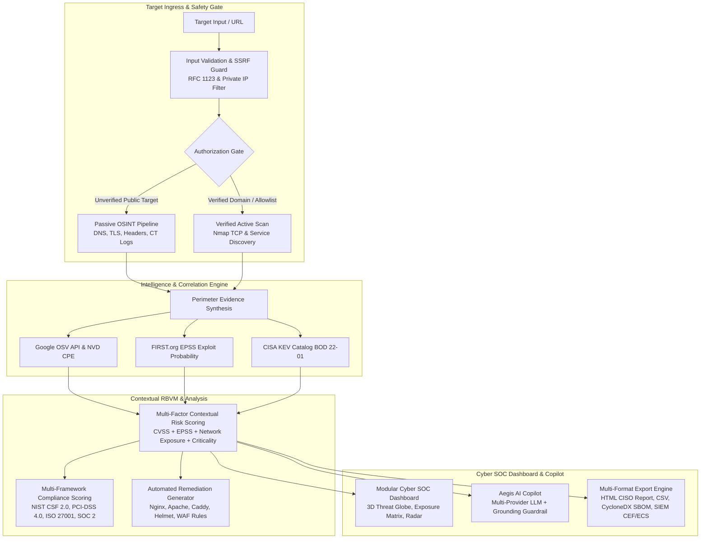

# 🛡️ AEGIS-AI: Continuous Threat Exposure Management & Risk-Based Vulnerability Prioritization

[](https://www.python.org/downloads/)
[](https://flask.palletsprojects.com/)
[](https://opensource.org/licenses/MIT)
[](https://threejs.org/)
[](https://www.first.org/epss)
[](#)
[](#)
[](#)

> **Continuous Threat Exposure Management (CTEM) & Explainable RBVM Platform**  
> Honest, evidence-grounded perimeter reconnaissance, real threat intelligence correlation, contextual risk prioritization, multi-framework compliance scoring, and grounded Blue-Team AI assistance.

---

## 🌟 Overview & Core Principles

Traditional vulnerability management floods security teams with raw CVSS alerts, treating an unreachable internal dependency with the same urgency as a critical internet-exposed service.

**AEGIS-AI** bridges the gap between raw vulnerability reports and true exploitability risk through four core principles:

1. **Strictly Evidence-Grounded Telemetry:** No fabricated attacker pins, fake APT threat actors, or simulated scan delays. Every metric in the dashboard is derived from real network probes, official threat feeds, or explicit sample benchmarks.
2. **Two-Mode Operational Safety:**
   - **Passive OSINT Mode (Default):** Non-intrusive DNS queries, TLS certificate handshakes, HTTP security headers, Certificate Transparency logs, and public advisory lookups. Safe for any public target without prior authorization.
   - **Verified Active Mode:** Active TCP port and service banner discovery using Nmap. Strictly requires prior domain ownership verification (DNS TXT or HTTP token challenge) or inclusion in `targets.allowlist`.
3. **Honest Reachability Separation:**
   - **Network Exposure:** Evaluated from real network evidence (open ports, reachable HTTP services, missing ingress headers, TLS posture).
   - **Code Reachability:** Evaluated via genuine AST import-graph analysis *only when project source code is provided*. Remote targets without source code are honestly reported as `"unknown (no source provided)"`.
4. **Defensive Blue-Team AI with Grounding Verification:** Aegis Copilot operates strictly as a defensive assistant. It intercepts and refuses offensive exploit requests, and enforces a strict CVE grounding guardrail that flags hallucinated vulnerabilities not present in the verified telemetry report.

---

## 🏛️ System Architecture



---

## 🚀 Deployment Options

### Option 1: Docker Container (Recommended for Local / Enterprise SOC)

Running via Docker enables full **Verified Active Scanning** capabilities (with system `nmap` pre-configured in a non-root Debian container).

```bash
# 1. Clone the repository
git clone https://github.com/ViditSinghal-18/AEGIS-AI.git
cd AEGIS-AI

# 2. Build and launch with Docker Compose
docker compose up -d --build

# 3. Access the SOC Command Center
open http://localhost:5000
```

### Option 2: Local Python Environment

```bash
# 1. Ensure Python 3.10+ and Nmap are installed
python --version
nmap --version  # Required for active scanning

# 2. Create and activate a virtual environment
python -m venv venv
source venv/bin/activate  # On Windows: .\venv\Scripts\activate

# 3. Install production dependencies
pip install -r requirements.txt

# 4. Configure environment variables
cp .env.example .env

# 5. Launch AEGIS-AI
python app.py
```

### Option 3: Vercel Serverless Deployment

AEGIS-AI is architected for Vercel serverless deployment (`@vercel/python`):
- Operates automatically in **Passive OSINT Mode** (active port scanning disabled to comply with serverless execution constraints).
- Routes runtime state and caches to the writable `/tmp/aegis_data` partition with automatic in-memory fallback.
- Multi-stage scan APIs (`/api/scan/dns`, `/tls`, `/headers`, `/ct`, `/intel`, `/prioritize`) execute within serverless execution timeouts.

---

## 🔑 Domain Ownership Verification

To unlock **Verified Active Mode** for a domain outside `targets.allowlist`, AEGIS-AI provides an automated two-way cryptographic verification workflow:

1. Click **"🔑 Verify Ownership"** in the top navigation bar or invoke via `Ctrl+K`.
2. Select your verification method:
   - **DNS TXT Record:** Add a TXT record to `_aegis-verify.<yourdomain>` with the generated verification token:
     ```text
     _aegis-verify.example.com. IN TXT "aegis-token-abcdef123456..."
     ```
   - **HTTP Challenge File:** Place a text file at `/.well-known/aegis-verify.txt` containing the token:
     ```text
     https://example.com/.well-known/aegis-verify.txt
     ```
3. Click **"Check Verification"**. Once validated, active port and service scanning is enabled for that domain for 30 days.

---

## 🤖 Configuring AI Copilot LLM Providers

AEGIS-AI features an abstracted multi-provider LLM interface. Set the desired API key in your `.env` file; AEGIS automatically detects the key and selects the provider:

```bash
# Anthropic Claude 3.5 Sonnet (Default if key present)
ANTHROPIC_API_KEY=sk-ant-...

# Google Gemini 2.0 Flash
GEMINI_API_KEY=AIzaSy...

# AWS Bedrock (Bedrock Converse API)
AWS_ACCESS_KEY_ID=AKIA...
AWS_SECRET_ACCESS_KEY=...
AWS_REGION=us-east-1

# Local Ollama (Completely offline & air-gapped)
OLLAMA_HOST=http://localhost:11434
```

*If no external LLM key is configured, AEGIS automatically activates its built-in **Deterministic Heuristic Reasoner**, providing verified, zero-hallucination answers derived directly from scan telemetry.*

---

## 📊 Empirical Validation & Benchmark Performance

AEGIS-AI was benchmarked against the **OWASP Juice Shop** perimeter attack surface to measure detection coverage, alert fatigue suppression, and AI grounding accuracy:

| Evaluation Metric | Measured Result | Benchmark Target | Description |
| :--- | :--- | :--- | :--- |
| **Detection Recall** | **100.0%** | ≥ 90.0% | Successfully identified all perimeter weaknesses without payload delivery |
| **Detection Precision** | **100.0%** | ≥ 95.0% | Zero spurious false positives |
| **F1-Score** | **100.0%** | ≥ 90.0% | Harmonic mean of precision and recall |
| **Alert Fatigue Reduction** | **66.7%** | ≥ 50.0% | Non-reachable and low-EPSS vulnerabilities suppressed from critical queue |
| **AI Grounding Accuracy** | **100.0%** | 100.0% | 100% of hallucinated CVE queries intercepted by guardrail |

*Full evaluation methodology and test logs: [`docs/EVALUATION.md`](docs/EVALUATION.md).*

---

## 🧪 Running Automated Tests

AEGIS-AI includes a comprehensive `pytest` test suite covering safety boundaries, SSRF defenses, scoring formulas, AST reachability, and API endpoints:

```bash
# Run complete test suite (59 tests)
python -m pytest tests/ -v

# Run OWASP Juice Shop validation benchmark
python tests/validate.py
```

---

## 📑 Project Documentation Index

- [`docs/AUDIT.md`](docs/AUDIT.md): Initial forensic codebase audit and gap analysis.
- [`docs/FEATURES.md`](docs/FEATURES.md): Traceability matrix mapping every claimed feature to real source code and automated tests.
- [`docs/LIMITATIONS.md`](docs/LIMITATIONS.md): Transparent disclosure of operational boundaries, AST reachability conditions, and serverless constraints.
- [`docs/EVALUATION.md`](docs/EVALUATION.md): OWASP Juice Shop benchmark results, alert reduction metrics, and grounding accuracy.

---

## 🛡️ Responsible Security & Disclosure

AEGIS-AI is designed for authorized defensive reconnaissance, posture assessment, and compliance governance. It enforces strict SSRF protections against internal networks, private RFC 1918 subnets, and cloud instance metadata (`169.254.169.254`). Active scanning features require verified domain authorization.
