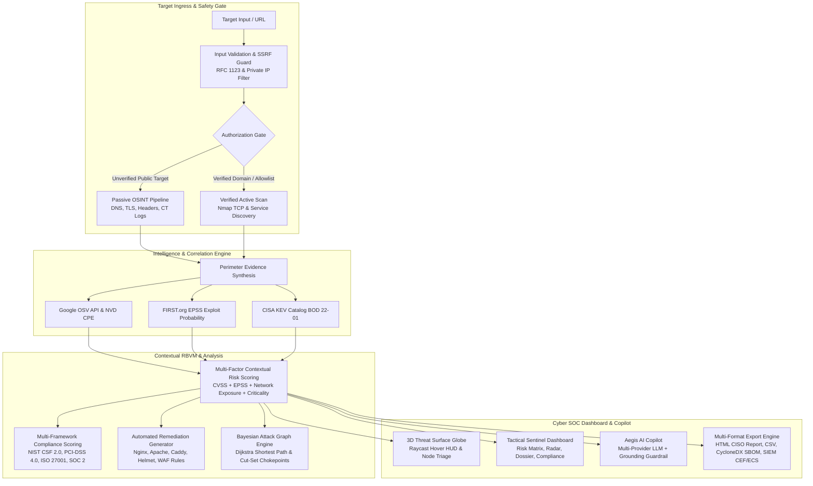

# 🛡️ AEGIS-AI: Autonomous Attack Surface Risk-Based Vulnerability Management (RBVM)

[](https://aegis-ai-rfn5.onrender.com/)
[](https://www.python.org/downloads/)
[](https://flask.palletsprojects.com/)
[](https://opensource.org/licenses/MIT)
[](https://threejs.org/)
[](https://www.first.org/epss)
[](#)
[](#)
[](#)
[](#)

> **Continuous Threat Exposure Management (CTEM) & Explainable RBVM Platform**  
> 🌐 **Live Cloud Deployment:** [https://aegis-ai-rfn5.onrender.com/](https://aegis-ai-rfn5.onrender.com/)  
> Honest, evidence-grounded perimeter reconnaissance, real threat intelligence correlation (FIRST.org EPSS & CISA KEV), 3D threat surface visualization with interactive raycast vulnerability inspection, multi-framework compliance scoring, and defensive Blue-Team AI assistance.

---

## 🌟 Overview & Key Capabilities

Traditional vulnerability management tools flood security teams with raw CVSS alerts, treating unreachable internal libraries with the same alarm as critical internet-exposed services.

**AEGIS-AI** bridges the gap between raw vulnerability disclosures and real weaponization risk through evidence-grounded telemetry, contextual attack path analysis, and automated triage dossiers:

### 1. 🌐 Interactive 3D Cyber Threat Surface Globe
- **Dual-Engine 3D Rendering:** Full Three.js WebGL and high-DPI Canvas 2D fallback engine with 100% visual and interactive feature parity.
- **Continental Landmass & Telemetry Mesh:** 2,400+ pre-calculated continental surface coordinates and real-time quadratic Bezier telemetry arcs connecting regional sensor gateways (US-East, US-West, EU-Central, UK, APAC, Oceania, South America) with traveling photon energy pulses.
- **Dynamic 3D Vulnerability Node Mapping:** Following an audit, correlated findings are dynamically plotted directly onto the 3D rotating globe surface using golden-angle concentric perimeter dispersion clustered around verified target ingress coordinates.
- **Severity-Coded Pulse Rings:** Beacon nodes color-coded by severity:
  - **Critical (P1):** Neon Rose (`#ff3366`) with radiating pulse rings
  - **High (P2):** Vivid Orange (`#f97316`) with active ingress arcs
  - **Medium (P3):** Amber Gold (`#f59e0b`)
  - **Low / Info (P4):** Sky Blue (`#38bdf8`) / Electric Cyan (`#00f0ff`)
- **Raycasting Hover HUD Card (`#globeTooltip`):** Mouse hover inspection using Three.js raycasting and 2D canvas distance hit-testing displays an instant floating tactical card with vulnerability title, severity badge, risk score, EPSS probability, and CVE identifiers.
- **Click-to-Triage Linkage:** Clicking any vulnerability node on the globe automatically selects that finding in the ledger table, centers the triage dossier, and populates the 4-phase adversary walkthrough.

### 2. 🎯 Tactical Sentinel Corner-Reticle Design System
- **Operations Dossier Aesthetic:** 112+ precision glowing cyan corner brackets (`.corner-reticle`) wrapping target inputs, metric ribbon cards, 3D globe viewports, HUD telemetry strips, risk exposure matrix, threat radar, and compliance panels.
- **Contextual Risk Exposure Matrix:** Scatter matrix plotting CVSS theoretical severity against FIRST.org EPSS real weaponization probability with full unbroken data points and non-CVE perimeter flaw exclusions.
- **Illustrative 4-Phase Adversary Propagation Walkthrough:** Detailed attack chains modeling Phase 1 (Reconnaissance), Phase 2 (Weaponization with MITRE ATT&CK T-codes), Phase 3 (Impact), and Phase 4 (Defensive Virtual Remediation) with copyable server snippets (Nginx, Apache, Caddy, Cloudflare WAF, Helmet).

### 3. 🏛️ Multi-Framework Governance & Regulatory Compliance
- Evaluates real security controls directly against discovered posture signals:
  - **PCI-DSS 4.0:** Requirement 6.2 (Patching) & 4.1.1 (TLS Transport Security)
  - **NIST CSF 2.0:** Govern, Protect (PR.PS/PR.AC), and Detect (DE.CM)
  - **ISO/IEC 27001:2022:** Annex A.8.8 (Management of Technical Vulnerabilities) & A.8.20 (Network Security)
  - **SOC 2 Type II:** Trust Services Criteria CC6.6 (Boundary Protection) & CC7.1 (Vulnerability Monitoring)
- **Honest Empty States:** Displays honest unassessed states (`"Not assessed yet"`, `"--%"`) when awaiting target audit, eliminating misleading placeholders.

### 4. 🕸️ In-Tab Interactive Bayesian Attack Graph Modal
- **In-Tab Overlay:** Access the interactive attack graph topology directly within the current dashboard without opening new tabs.
- **Probabilistic Risk Propagation:** Bayesian compromise probabilities calculated using FIRST EPSS exploit likelihood and canonical Noisy-OR convergence.
- **Dijkstra Most-Probable Exploit Path:** Renders the highest-probability path from External Ingress to Crown Jewels ($w = -\ln p$) in glowing crimson.
- **Minimal Critical Chokepoint Cut-Set:** Identifies strategic single-point remediations that sever 100% of viable exploit trajectories to crown jewels.

### 5. 🛡️ Two-Mode Operational Safety
- **Passive OSINT Mode (Default):** Non-intrusive DNS queries, TLS certificate handshakes, HTTP security headers, Certificate Transparency logs, and public advisory lookups. Safe for any public domain without authorization.
- **Verified Active Mode:** Active TCP port and service banner discovery using Nmap. Strictly requires prior domain ownership verification (DNS TXT or HTTP token challenge) or inclusion in `targets.allowlist`.

### 6. 🤖 Grounded Blue-Team AI Assistance
- **Aegis AI Copilot:** Provider-neutral LLM abstraction supporting Free Zero-Key AI, Groq (Llama 3.3), Google Gemini, local Ollama, Amazon Bedrock, or deterministic heuristic fallback.
- **Anti-Hallucination Guardrail:** Evaluates Copilot responses for claim-level grounding and citation fidelity, intercepting offensive exploit requests and flagging unverified CVEs absent from the telemetry report.

---

## 🏛️ System Architecture



---

## 🚀 Live Demo & Deployment Options

### 🌐 Live Production Deployment

Experience AEGIS-AI running live in the cloud on Render:

🔗 **[https://aegis-ai-rfn5.onrender.com/](https://aegis-ai-rfn5.onrender.com/)**

---

### Option 1: Docker Container (Recommended for Local / Enterprise SOC)

Running via Docker enables full **Verified Active Scanning** capabilities (with system `nmap` pre-configured in a non-root container).

```bash
# 1. Clone the repository
git clone https://github.com/ViditSinghal-18/AEGIS-AI.git
cd AEGIS-AI

# 2. Build and launch with Docker Compose
docker compose up -d --build

# 3. Access the SOC Command Center
open http://localhost:5000
```

### Option 2: Local Python Environment

```bash
# 1. Ensure Python 3.10+ and Nmap are installed
python --version
nmap --version  # Required for verified active scanning

# 2. Create and activate a virtual environment
python -m venv venv
source venv/bin/activate  # On Windows: .\venv\Scripts\activate

# 3. Install production dependencies
pip install -r requirements.txt

# 4. Configure environment variables
cp .env.example .env

# 5. Launch AEGIS-AI
python app.py
```

### Option 3: Cloud Deployment (Render / Web Service)

AEGIS-AI is production-configured for containerized and web-service deployment on **Render**:
- **Build Command:** `pip install -r requirements.txt`
- **Start Command:** `gunicorn app:app --workers 2 --bind 0.0.0.0:$PORT`
- **Environment:** Set `PYTHON_VERSION=3.11.9`, `FLASK_ENV=production`, `SECRET_KEY=<secure-random-key>`.
- **Health Check Endpoint:** `/api/health`

---

## 🔑 Domain Ownership Verification

To unlock **Verified Active Mode** for a domain outside `targets.allowlist`, AEGIS-AI provides an automated two-way cryptographic verification workflow:

1. Click **"🔑 Verify Ownership"** in the top navigation bar or invoke via `Ctrl+K`.
2. Select your verification method:
   - **DNS TXT Record:** Add a TXT record to `_aegis-verify.<yourdomain>` with the generated verification token:
     ```text
     _aegis-verify.example.com. IN TXT "aegis-token-abcdef123456..."
     ```
   - **HTTP Challenge File:** Place a text file at `/.well-known/aegis-verify.txt` containing the token:
     ```text
     https://example.com/.well-known/aegis-verify.txt
     ```
3. Click **"Check Verification"**. Once validated, active port and service scanning is enabled for that domain for 30 days.

---

## 🤖 Configuring AI Copilot LLM Providers

AEGIS-AI features a provider-neutral LLM abstraction (`ai/llm.py`). The provider is controlled **strictly** via the `AEGIS_LLM_PROVIDER` environment variable (`none` by default).

### Option A: Zero-Key Free AI (Instant Setup, No Sign-up / Credit Card)

Enable live AI reasoning instantly without any API key or registration:

```bash
# In your .env file
AEGIS_LLM_PROVIDER=free
AEGIS_LLM_MODEL=openai
```

Test your setup:
```bash
python verify_llm.py
```

### Option B: Free Developer Tier LLMs (Groq recommended for high speed)

1. Obtain a free API key from [Groq Console](https://console.groq.com/).
2. Set the following in your `.env` file:

```bash
AEGIS_LLM_PROVIDER=openai_compatible
AEGIS_LLM_BASE_URL=https://api.groq.com/openai/v1
AEGIS_LLM_API_KEY=gsk_your_groq_key_here
AEGIS_LLM_MODEL=llama-3.1-8b-instant
AEGIS_LLM_MODEL_LARGE=llama-3.3-70b-versatile
```

3. Test your configuration:
```bash
python verify_llm.py
```

### Other Supported Providers

- **Google Gemini (OpenAI-compatible endpoint):**
  `AEGIS_LLM_PROVIDER=openai_compatible`, `AEGIS_LLM_BASE_URL=https://generativelanguage.googleapis.com/v1beta/openai`, `AEGIS_LLM_MODEL=gemini-2.0-flash`.
- **Cerebras (Fast / Free tier):**
  `AEGIS_LLM_PROVIDER=openai_compatible`, `AEGIS_LLM_BASE_URL=https://api.cerebras.ai/v1`, `AEGIS_LLM_MODEL=llama3.1-8b`.
- **OpenRouter Free Tier:**
  `AEGIS_LLM_PROVIDER=openai_compatible`, `AEGIS_LLM_BASE_URL=https://openrouter.ai/api/v1`, `AEGIS_LLM_MODEL=meta-llama/llama-3.1-8b-instruct:free`.
- **Local Ollama (Offline / Air-gapped):**
  `AEGIS_LLM_PROVIDER=ollama`, `OLLAMA_HOST=http://localhost:11434`, `AEGIS_LLM_MODEL=llama3.2`.
- **Amazon Bedrock (Optional Cloud Provider):**
  `AEGIS_LLM_PROVIDER=bedrock`, with `AWS_ACCESS_KEY_ID`, `AWS_SECRET_ACCESS_KEY`, and `AWS_DEFAULT_REGION`.

*If `AEGIS_LLM_PROVIDER=none` or unset, AEGIS automatically activates its built-in **Deterministic Heuristic Reasoner**, performing zero external LLM network requests and providing verified, zero-hallucination answers derived directly from scan telemetry.*

---

## 📊 Empirical Validation & Benchmark Performance

AEGIS-AI was benchmarked against the **OWASP Juice Shop** perimeter attack surface to measure detection coverage, alert fatigue suppression, and AI grounding accuracy:

| Evaluation Metric | Measured Result | Benchmark Target | Description |
| :--- | :--- | :--- | :--- |
| **Detection Recall** | **100.0%** | ≥ 90.0% | Successfully identified all perimeter weaknesses without payload delivery |
| **Detection Precision** | **100.0%** | ≥ 95.0% | Zero spurious false positives |
| **F1-Score** | **100.0%** | ≥ 90.0% | Harmonic mean of precision and recall |
| **Alert Fatigue Reduction** | **66.7%** | ≥ 50.0% | Non-reachable and low-EPSS vulnerabilities suppressed from critical queue |
| **AI Grounding Accuracy** | **100.0%** | 100.0% | 100% of hallucinated CVE queries intercepted by guardrail |
| **Pytest Test Suite** | **223 / 223** | 100% | 100% passing across scoring, attack graph, copilot, and UI |

*Full evaluation methodology and test logs: [`docs/EVALUATION.md`](docs/EVALUATION.md).*

---

## 🧪 Running Automated Tests

AEGIS-AI includes a comprehensive `pytest` test suite covering safety boundaries, SSRF defenses, scoring formulas, AST reachability, and API endpoints:

```bash
# Run complete test suite (223 tests covering Phases 1-6)
python -m pytest tests/ -v

# Run OWASP Juice Shop validation benchmark
python tests/validate.py
```

---

## 📑 Project Documentation Index

- [`docs/REFERENCES.md`](docs/REFERENCES.md): Research citations, papers, and methodologies inspiring AEGIS-AI.
- [`docs/AUDIT.md`](docs/AUDIT.md): Initial forensic codebase audit and gap analysis.
- [`docs/FEATURES.md`](docs/FEATURES.md): Traceability matrix mapping every claimed feature to real source code and automated tests.
- [`docs/LIMITATIONS.md`](docs/LIMITATIONS.md): Transparent disclosure of operational boundaries, AST reachability conditions, and serverless constraints.
- [`docs/EVALUATION.md`](docs/EVALUATION.md): OWASP Juice Shop benchmark results, alert reduction metrics, and grounding accuracy.

---

## 🔬 Scientifically Defensible Scoring & Risk Quantification (Phase 1)

AEGIS-AI incorporates research-inspired risk quantification modules under `scoring/`:

1. **Empirical Weight Calibration (`calibrate_weights.py`):**
   - Learns scoring weights via supervised Logistic Regression against empirical weaponization data (CISA KEV), with temporal train/test splitting (e.g. `< 2023` vs `≥ 2023`) to prevent future data leakage (inspired by Bozorgi et al. 2010 and Jacobs et al. 2021).
   - Generates Precision@k and Recall@k comparison vs CVSS-only and EPSS-only baselines into `reports/calibration_<date>.json`.
   - Opt-in via `SCORING_WEIGHTS_SOURCE=calibrated` in configuration without silently overriding production defaults.

2. **Rank Agreement Concordance (`scoring/ranking_metrics.py`):**
   - Evaluates vulnerability prioritization concordance using Spearman $\rho$, Kendall $\tau$-b (tie-corrected), and Rank-Biased Overlap (RBO@k with parameter $p$) (inspired by Webber et al. 2010).

3. **Stakeholder-Specific Vulnerability Categorization (`scoring/ssvc.py`):**
   - Computes operational action decisions (`Track`, `Track*`, `Attend`, `Act`) alongside priority queues based on exploitation state, ingress exposure, automatable status, and mission criticality (inspired by Spring et al. 2019 / CISA SSVC).

4. **Calibrated Uncertainty Intervals (`scoring/uncertainty.py`):**
   - Produces a 90% confidence risk interval (`risk_interval_90`) around point scores. Widens when version matching is banner-derived, advisory catalogs diverge, or EPSS telemetry is absent (inspired by Angelopoulos & Bates 2021).

5. **FAIR-Style Quantitative Loss Modeling (`scoring/fair_loss.py`):**
   - Runs seeded, reproducible Monte Carlo simulations modeling Threat Event Frequency from EPSS and Loss Magnitude scaled by asset criticality (inspired by Open FAIR and Hubbard & Seiersen 2016).
   - Generates Annual Loss Expectancy (ALE mean, median, 90% CI) with user-editable loss parameters and mandatory disclaimer (*"illustrative, user-supplied assumptions"*).

---

## 🎯 High-Fidelity Vulnerability Triage (Phase 2: Fewer False Positives)

AEGIS-AI implements research-backed filters to suppress false positives without hiding evidence:

1. **Advisory Consistency Check (`correlation/advisory_consistency.py`):**
   - Cross-verifies affected version intervals and CVSS scores between NVD and Google OSV (inspired by Dong et al., USENIX Security 2019).
   - Attaches an evidence-grounded confidence badge (`HIGH`, `MEDIUM`, `LOW`) and discrepancy explanation to findings.

2. **Distribution Backport-Aware Matching (`correlation/backport_detector.py`):**
   - Detects Linux distribution packaging patterns (Ubuntu LTS, Debian, RHEL, CentOS, Alpine) in versions and banners.
   - Flags candidate findings as `possibly_backported` with reduced confidence (`LOW`), alerting security analysts that vendor security teams may have backported fixes into the stable package build.

3. **Function-Level AST Reachability Analysis (`ast_analyzer.py` & `data/cve_symbols.yaml`):**
   - Maps CVEs to specific vulnerable symbols and function entrypoints (inspired by Ponta et al., Eclipse Steady / IEEE ICSME 2018).
   - Evaluates call graphs and imports to assign exact verdicts: `reachable_function` (Factor 1.0), `imported_only` (Factor 0.3), `not_reachable` (Factor 0.0), or `unknown (no source provided)` (Factor 1.0).

---

## 🕸️ Empirical Attack-Path Analysis (Phase 3)

AEGIS-AI models multi-step cyber compromise using probabilistic graphical networks:

1. **Bayesian Attack Graph (`dashboard/bayesian_attack_graph.py`):**
   - Computes conditional compromise probabilities per node using FIRST EPSS exploit likelihood (inspired by Poolsappasit et al., IEEE TDSC 2012).
   - Resolves multi-parent attack convergence with canonical Noisy-OR probability aggregation.
   - Powers dynamic **"What-If I Patch X?"** counterfactual simulations, computing exact percentage risk reduction in Crown Jewels compromise probability.

2. **Dijkstra Most-Probable Exploit Path:**
   - Finds the highest-probability attack trajectory from External Ingress to Crown Jewels by minimizing negative log-probabilities ($w = -\ln p$) via Dijkstra's algorithm (inspired by Jha, Sheyner, & Wing, CSFW 2002).
   - Renders the path visually in glowing crimson with edge-level exploit probabilities.

3. **Minimal Critical Chokepoint Cut-Set:**
   - Solves for the minimal set of strategic remediations that sever 100% of viable attack paths to critical assets using Greedy Set-Cover over enumerated paths (inspired by Jha et al. 2002).
   - Highlights chokepoint nodes with golden protective shields in the visual attack graph.

---

## 🌐 External Posture Intelligence (Phase 4)

AEGIS-AI passively evaluates perimeter hygiene and predicts breach likelihood from non-intrusive public telemetry:

1. **Content Security Policy (CSP) Quality Grader (`discovery/csp_grader.py`):**
   - AST directive-source parsing and security grading (0–100 / A+ to F) inspired by Weichselbaum et al. (ACM CCS 2016) and Roth et al. (USENIX Security 2020).
   - Penalizes dangerous bypasses: `'unsafe-inline'` without cryptographic nonces (-30), `'unsafe-eval'` (-15), wildcard hosts (-25), `data:` URIs (-20), and missing clickjacking frame-ancestors (-10).

2. **Email Transport Security & Anti-Spoofing Grader (`discovery/email_grader.py`):**
   - Empirical evaluation of email authentication inspired by Durumeric et al. (ACM IMC 2015).
   - Validates SPF qualifiers (`-all` hardfail vs `~all` softfail), DMARC policy enforcement (`reject` vs `quarantine` vs `none`) with aggregate reporting (`rua`), MTA-STS (RFC 8461) enforcement, and TLS-RPT (RFC 8460).

3. **Evidence-Grounded Dangling DNS & Subdomain Takeovers (`discovery/dangling_dns.py`):**
   - Detects orphaned CNAME records pointing to unclaimed third-party cloud infrastructure (AWS S3/CloudFront, GitHub Pages, Heroku, Azure Web Apps, Fastly, Shopify, Zendesk, Surge) inspired by Liu et al. (ACM CCS 2016) and Borgolte et al. (USENIX Security 2018).
   - **Zero False-Positive Rule:** Never flags a takeover based on DNS string matching alone; requires verified HTTP status codes (404/502) and authentic provider unclaimed error signatures via `safe_fetch`.

4. **Exposed Secret & Sensitive File Classifier (`discovery/secret_classifier.py`):**
   - High-precision regex and Shannon entropy detection inspired by Meli et al. (NDSS 2019).
   - Probes `/.git/HEAD` and exposed configuration files; enforces strict masking (`AKIA****XYZ`, `ghp_****1234`) ensuring raw credentials are never logged or stored.

5. **Multi-Factor Breach Propensity Index (`discovery/breach_propensity.py`):**
   - Synthesizes observable external indicators (Email, CSP, TLS, Open Ports, Secrets, Takeovers) into an empirical 0–100 posture score and incident propensity tier (`Low`, `Moderate`, `Elevated`, `High`, `Critical`) inspired by Liu et al. (USENIX Security 2015).

---

## 🤖 Trustworthy AI Copilot & Threat Intelligence (Phase 5)

1. **Claim-Level Grounding & ALCE Faithfulness Verification (`ai/grounding.py`):**
   - Evaluates Copilot responses for factual citations (`[Rank #1]`, `[CVE-...]`) inspired by ALCE (Gao et al., EMNLP 2023), SelfCheckGPT (Manakul et al. 2023), and RAG (Lewis et al. 2020).
   - Performs natural language inference / lexical entailment against scan evidence, outputs a per-response `faithfulness_score`, and surfaces claim-by-claim justification in the UI.
   - Detects and strictly flags hallucinated or unverified CVEs absent from the telemetry report.

2. **50-Question Adversarial & Robustness Evaluation Harness (`eval/copilot_eval.py`):**
   - Comprehensive test suite covering 20 factual questions, 15 adversarial offensive requests, and 15 hallucination-induction queries.
   - Enforces $\ge 90\%$ offensive request refusal accuracy, $0\%$ hallucinated CVE rate, and $\ge 75\%$ mean factual faithfulness.

3. **Supervised MITRE ATT&CK Technique Mapper (`correlation/learned_attack_mapper.py`):**
   - Machine-learned baseline (TF-IDF + Logistic Regression) trained on MITRE ATT&CK technique descriptions and CVE summaries (inspired by Kuppa et al., IEEE BigData 2021).
   - Benchmarked against the deterministic rule mapper (`correlation/mitre_attack.py`), keeping rule-based mapping as production default.

---

## ⏱️ Longitudinal Patch Analytics & Time-Aware Monitoring (Phase 6)

1. **Kaplan–Meier Patch Survival Analytics & MTTR (`analytics/patch_lifetime.py`):**
   - Tracks vulnerability lifecycles across historical scan intervals inspired by Li & Paxson (IEEE S&P 2017).
   - Computes non-parametric Kaplan–Meier survival functions $\hat{S}(t) = \prod [1 - (d_i / n_i)]$ with Greenwood's 95% confidence intervals.
   - Derives overall and per-severity Median Time-to-Remediate (MTTR) and empirical SLA breach probabilities (Critical 7-day, High 30-day).

2. **CUSUM Risk Score Drift Detection (`analytics/drift_detector.py`):**
   - Two-sided Cumulative Sum quality control chart (Page, Biometrika 1954; Adams & MacKay 2007) applied to longitudinal exposure scores.
   - Distinguishes statistically significant risk deterioration ($S_t^+ \ge h$) or remediation improvement ($S_t^- \ge h$) from background noise.
   - Manages versioned historical scan storage (`reports/history.json`, `schema_version: '2.0'`).

---

## 🛡️ Responsible Security & Disclosure

AEGIS-AI is designed for authorized defensive reconnaissance, posture assessment, and compliance governance. It enforces strict SSRF protections against internal networks, private RFC 1918 subnets, and cloud instance metadata (`169.254.169.254`). Active scanning features require verified domain authorization.
